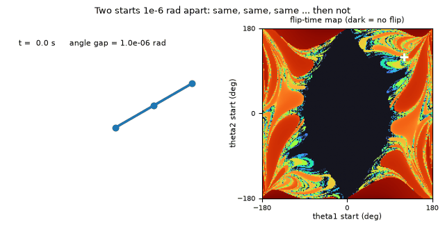
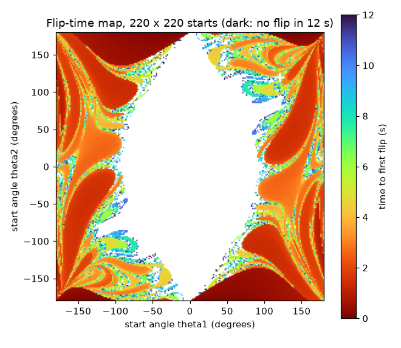
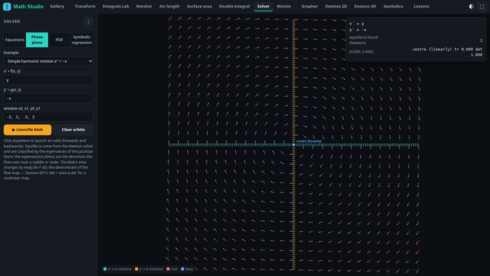
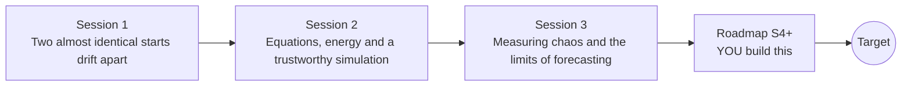

# openchaos

[](https://github.com/KrunalPanchal1995/openchaos/actions/workflows/ci.yml)   [](https://colab.research.google.com/github/KrunalPanchal1995/openchaos/blob/main/sessions/session-01/lesson.ipynb) [](https://krunalpanchal1995.github.io/openchaos/)

**See chaos in a double pendulum, in three sessions.**

openchaos teaches how a perfectly deterministic pendulum becomes unpredictable, from one swinging rod to Lyapunov exponents and a map of chaos, using only Python and a browser.

- **Start from one pendulum.** Session 1 needs only school trigonometry and shows chaos by experiment before any theory.
- **See it diverge.** Every session ships a slider app that runs in the browser, with labelled graphs.
- **Know the answer is right.** Each session ends with a checkpoint that tests energy conservation, the small-angle limit and hand calculations.
- **Build the missing half.** The repo stops at Session 3 on purpose; the roadmap shows the path to the Target.

[Target](#the-target) · [Who is this for](#who-is-this-for) · [Quick start](#quick-start) · [Sessions](#sessions) · [Roadmap](#roadmap) · [Contribute](#contribute) · [Explainer PDF](docs/explainer.pdf)

> **This repo is incomplete on purpose.** Sessions 1 to 3 are here and fully working. The finished Target below is a preview of what the community can build next. We show you the path, not the code. Sessions 4 and up are yours.

## The Target

Two double pendulums are released 1e-6 rad apart (about a thousandth of a degree) and drawn with fading trails. For about nine seconds the blue and the orange pendulum move as one; then they fly apart and never agree again. Beside them a flip-time map shows, for every release angle, how long the outer rod takes to flip over: a calm dark region where the motion is regular and a speckled sea where it is chaotic. Your goal over the coming sessions: build the divergence animation and the map yourself, and learn how long such a forecast can be trusted.



*Target: two double pendulums 1e-6 rad apart diverge, beside a flip-time map*



*Target: flip-time map of 220 x 220 release angles (dark = no flip)*



*Math Visual Studio: a solver drawing a phase plane*

Try it live:

- [Math Visual Studio: double pendulum project (Atlas S101)](https://krunalpanchal1995.github.io/studio/#atlas?ch=S101&ex=1)

How the Target was made is shown only as a path in [promo/roadmap.md](promo/roadmap.md).

## Who is this for
**secondary school to diploma / undergraduate (levels 3-5).** Topic area: Physics and the Science of Motion.

Prerequisites:

- Sine and cosine of an angle (school trigonometry); radians are explained from scratch.
- Python 3.10 or newer; if `python --version` works, you are ready. PRIMER.md explains the rest.
- No prior GitHub, mechanics or calculus experience is needed for Session 1; Sessions 2 and 3 use derivatives in words and formulas.

New to Python? Read [PRIMER.md](PRIMER.md) first (10 minutes).

## Quick start

No installation knowledge needed. You need [Git](https://git-scm.com/downloads) and [Python 3.10+](https://www.python.org/downloads/) (Windows: tick "Add Python to PATH"). On Mac and Linux type `python3` wherever this page says `python`.

```bash
git clone https://github.com/KrunalPanchal1995/openchaos.git
cd openchaos
python start.py 1
```

`start.py` creates a private environment, installs what is needed and runs Session 1 with its checkpoint. Next: `python start.py 2`, `python start.py 3`, or `python start.py test` to check everything. Only a checkpoint: `python start.py check 1`.

Four lines show the heart of Session 1: the swing time of a pendulum from its length (they work as they are): Save it as `try.py` and run it with `python start.py run try.py` (this uses the private environment, where NumPy is installed):

```python
import numpy as np
g, L = 9.81, 1.0                      # gravity in m/s^2, pendulum length in m
period = 2 * np.pi * np.sqrt(L / g)   # swing time of a small swing, in seconds
print(round(period, 3), 's')          # -> 2.006 s: a 1 m pendulum swings about once every 2 s
```

Every session also opens in your browser with sliders (no install): [live apps](https://krunalpanchal1995.github.io/openchaos/). Or use the Colab badge above for the notebook.

## Sessions

| # | Session | Model level | Time | Live app |
|---|---|---|---|---|
| 1 | [Two almost identical starts drift apart](sessions/session-01/README.md) | Level 1: conceptual interactive model | 60 min | [open](https://krunalpanchal1995.github.io/openchaos/session-01/) |
| 2 | [Equations, energy and a trustworthy simulation](sessions/session-02/README.md) | Level 2: mathematical engineering model | 75 min | [open](https://krunalpanchal1995.github.io/openchaos/session-02/) |
| 3 | [Measuring chaos and the limits of forecasting](sessions/session-03/README.md) | Level 3: simulation and validation | 90 min | [open](https://krunalpanchal1995.github.io/openchaos/session-03/) |

Each session follows the same six steps: A real-world problem, B concept and theory, C visual explanation, D interactive simulation, E worked example and experiment, F assessment and design challenge. Each ends with `checkpoint.py`, which prints `PASS` or `FAIL` against reference numbers. Session 3 also contains the real-world mini-project: **How long can you forecast a double pendulum?**.

## Architecture



| Folder or file | What is inside |
|---|---|
| `sessions/` | three sessions: README (A-F), `lesson.py`, notebook, live app, exercises, activity sheet, checkpoint |
| `promo/` | the Target: media, live links, and the roadmap (path only) |
| `docs/` | `explainer.tex` and the built `explainer.pdf` |
| `tests/` | runs every lesson and checkpoint headless |
| `start.py` | one command to set up and run anything |
| `QUALITY.md`, `RUBRIC.md` | the quality checklist and the scoring rubric |
| `.github/` | CI, PDF build, Pages deploy, issue and PR templates |

## Roadmap

| Milestone | What you will build | Difficulty |
|---|---|---|
| Session 4: A fourth-order symplectic solver | A solver whose energy error stays bounded and small at a coarse step. | intermediate |
| Session 5: The full Lyapunov spectrum | All four exponents of the 120 degree release instead of the largest one only. | advanced |
| Session 6: Ensemble forecasts | 1000 forecasts from a Gaussian cloud of start errors of 1e-6 rad. | intermediate |
| Session 7: A damped, real pendulum | A damped model and a fit routine run on a synthetic measurement. | intermediate |
| Session 8: Chaos for unequal masses | Flip-time maps for general masses and rods. | advanced |

Full detail with a checkpoint per milestone: [promo/roadmap.md](promo/roadmap.md).

## Contribute
New to GitHub? Read [CONTRIBUTING.md](CONTRIBUTING.md); it starts from zero. Pick an issue labelled `good first issue`. Translations into Hindi, Telugu, Tamil and Malayalam are welcome.

<details>
<summary>Development</summary>

```bash
python start.py test        # runs every lesson and checkpoint
```
Lessons use `# %%` cell markers so they open as notebooks in VS Code. See [QUALITY.md](QUALITY.md) for the standard every session meets.
</details>

## License
MIT. See [LICENSE](LICENSE). Media in `promo/media` is (c) Krunal Panchal, CC BY 4.0.

## Acknowledgments
Part of the [PAN IIT OSS](https://hellofoss.tech-iitb.org/projects) open-source teaching collection, modelled on the structure of [openspline](https://github.com/openspline/openspline). Built on ideas from the Math Visual Studio at https://krunalpanchal1995.github.io/studio/.
