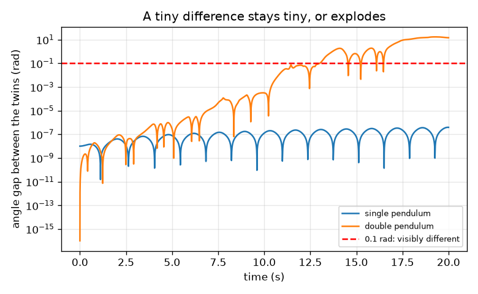
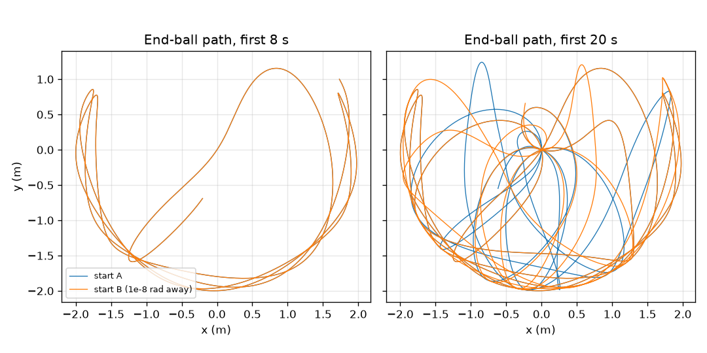

# Session 1: Two almost identical starts drift apart

*Level 1 (conceptual interactive model) · about 60 minutes · openchaos*

> This is a simplified educational model. It is not a validated design tool and must not be used for real structures, electrical installations, vehicles, industrial processes or medical decisions.

**Prerequisites**

- School trigonometry: sine and angles.
- You have read PRIMER.md and run `python start.py 1` once.

**Learning objectives.** After this session you can:

- Explain why a single pendulum is predictable and what that means for two nearly identical starts.
- Simulate a single and a double pendulum with the Runge-Kutta 4 rule.
- Measure how a start difference of 1e-8 rad grows in each system.
- Read a log-scale graph and say how fast a gap grows.

## A. Real-world problem
A grandfather clock swings the same way every time: if you know how it starts, you know where it will be in an hour. Hang a second pendulum from the end of the first and the motion looks random. Is it really random, or does it follow rules we simply cannot follow far enough? Release two double pendulums with starting angles that differ by one hundred-millionth of a radian and see for yourself.

## B. Concept and theory
A pendulum is a ball on a rod that swings under gravity. Its angle theta, measured from straight down, obeys theta'' = -(g / L) sin(theta): the pull of gravity back towards the bottom is proportional to sin(theta). For small swings sin(theta) is about theta and the swing time is T = 2 pi sqrt(L / g). A double pendulum has a second rod hung from the first ball, so two angles (theta1 for the upper rod, theta2 for the lower rod) and two angular speeds describe it; the lower ball is pulled by gravity and by the motion of the upper one. The rule is exact and has no randomness: the same start always gives the same motion. What changes is the sensitivity: we run two copies whose start differs by a tiny amount and track the gap between them. In the single pendulum the gap stays tiny. In the double pendulum it grows by roughly the same factor in every equal time interval, so it explodes after a few seconds. This is called sensitive dependence on initial conditions.

| Symbol | Meaning | Unit |
|---|---|---|
| theta | angle from straight down | rad |
| omega | angular speed, the rate of change of theta | rad/s |
| L | rod length (1 m here) | m |
| g | gravity | m/s^2 |
| T | swing time of a small swing | s |
| delta | difference between the two starting angles | rad |
| gap | absolute difference between the two angles at time t | rad |

**Assumptions**

- No friction or air resistance: rods are rigid and light, the balls are points of 1 kg each, both rods are 1 m long.
- Angles are measured from straight down; every start is at rest (zero angular speeds).
- Both twins are run by the same numerical rule (RK4 with step 0.005 s), so the gap measures how sensitive the motion is; Session 3 shows how the solver's own error limits how long one run follows the true motion.
- A radian is the angle unit used by the computer: 1 degree is 0.01745 rad.

$$ \ddot\theta=-\frac{g}{L}\sin\theta,\qquad T\approx 2\pi\sqrt{\frac{L}{g}}\ \text{(small swings)} $$

$$ \text{gap}(t)=\left|\theta_2^{B}(t)-\theta_2^{A}(t)\right|,\qquad \text{gap}(t)\approx \delta\,e^{\lambda t}\ \text{while the gap is small (chaotic case)} $$

## C. Visual explanation
Figure 1 draws the end-ball path of two double pendulums released from rest with both rods at 120 degrees, one of them 1e-8 rad away: for the first 8 seconds the two paths lie on top of each other, and after 20 seconds they have nothing in common. Figure 2 plots the gap on a logarithmic axis: the single pendulum's gap stays below 4e-7 rad for all 20 s, while the double pendulum's gap is 2.8e-7 rad at 5 s, 3.2e-4 rad at 10 s, 0.62 rad at 15 s and passes 0.1 rad at 13.0 s. A straight rising line on a log axis means growth by the same factor in each equal time step.

*Angle gap on a log axis: flat for the single pendulum, an explosion for the double pendulum.*

*End-ball paths of two double pendulums 1e-8 rad apart: identical at first, unrelated after 20 s.*

## D. Interactive simulation
Run the lesson (`python start.py 1`), then open the live app: [Session 1: two almost identical starts](https://krunalpanchal1995.github.io/openchaos/session-01/) (or `app.html` in this folder). Choose the release angle and the size of the start difference, drag the time slider and watch the two pendulums on the picture view; then open the gap graph and compare the double and the single pendulum.

**Challenge.** Find a release angle for which the double-pendulum twins stay within 0.1 rad for the whole 20 s.

## E. Worked example and experiment
**Problem.** A 1 m pendulum swings through a small angle. Find its swing time from the formula and compare it with the simulation.

1. The formula is T = 2 pi sqrt(L / g) with L = 1 m and g = 9.81 m/s^2.
2. L / g = 1 / 9.81 = 0.10194 s^2, and its square root is 0.31928 s.
3. T = 2 pi x 0.31928 = 2.0061 s.
4. The simulation with a 2 degree release, measured from the time the pendulum returns to its release point, gives 2.006 s.
5. Sanity check: a pendulum about one metre long ticks roughly once every two seconds, as in a grandfather clock (a 'seconds pendulum' beats seconds, so one full swing there takes 2 s).

**Answer.** T = 2.006 s from the formula and 2.006 s from the simulation.

**Experiment.** Tie a small weight to a 1 m string, release it from about 10 degrees and time 10 full swings with a phone stopwatch: expect about 20 s (2.0 s per swing). Differences come from reaction time (about 0.2 s on 20 s, so 1 percent), a finite amplitude (a 10 degree swing is 0.2 percent longer), the string stretching and the size of the weight; the model has a point ball and a stiff massless rod. Then hang a second weight from the first and release it twice by hand: the two motions never repeat, because your hand cannot repeat a start to 1e-8 rad (one degree is already 0.017 rad), and real friction slowly removes the energy that fuels the chaos.

## F. Assessment and design challenge
**Question type A: Conceptual.** A friend says: the double pendulum moves randomly, so no equation can describe it. Explain what is right and what is wrong in that sentence.

Hint

Ask whether the same start always gives the same motion, and what the gap graph shows about the start.

Step-by-step solution

The motion looks random but is not: the equations are exact and the same start always gives the same motion (it is deterministic). What is true is that the motion is extremely sensitive to the start: a difference of 1e-8 rad grows to more than 0.1 rad in about 13 s, so we cannot predict it far ahead unless we know the start almost perfectly. Chaos means unpredictable in practice, not lawless.

**Question type B: Numerical.** Find the swing time of a pendulum 0.25 m long with the formula T = 2 pi sqrt(L / g). Is it more or less than the 1 m pendulum, and by what factor?

Hint

Put L = 0.25 m and g = 9.81 m/s^2 into the formula; then compare with 2.006 s.

Step-by-step solution

L / g = 0.25 / 9.81 = 0.02548 s^2, sqrt = 0.1596 s, T = 2 pi x 0.1596 = 1.003 s. It is half of 2.006 s: four times shorter gives half the swing time (T goes as the square root of L). Units: seconds.

**Question type C: Graph and simulation interpretation.** On the gap graph, the double pendulum's gap grows from 3.2e-4 rad at 10 s to 0.62 rad at 15 s. By what factor does it grow in those 5 s, and what is the growth rate per second?

Hint

Divide the two gaps, then take the natural logarithm and divide by 5 s.

Step-by-step solution

The factor is 0.62 / 3.2e-4 = about 1950. The natural logarithm of 1950 is 7.58, so the rate is 7.58 / 5 s = 1.5 per second (the gap multiplies by about 4.5 every second). This rate, called the Lyapunov exponent, is measured properly in Session 3.

**Question type D: Design and optimisation challenge.** Design: you may measure the starting angle with a protractor of precision 1e-3 rad. Using a growth rate of 1.5 per second, how long can you forecast to within 0.1 rad? What precision would 10 s need? State your assumption.

Hint

The gap is about delta x exp(1.5 t); solve for t when it reaches 0.1, then solve for delta at t = 10 s.

Step-by-step solution

From delta e^(1.5 t) = 0.1 we get t = ln(0.1 / 1e-3) / 1.5 = ln(100) / 1.5 = 4.605 / 1.5 = 3.1 s. For 10 s we need delta = 0.1 e^(-15) = 3e-8 rad, thirty thousand times better than the protractor. Assumption: the growth is a clean exponential from the start; the real gap grows more slowly at first (see the graph), so these numbers are rough. Trade-off: each extra second of forecast needs the start known e^1.5 = 4.5 times better.

Score yourself with [RUBRIC.md](../../RUBRIC.md). Print the [activity sheet](activity_sheet.md) to work on paper.

## Common misconceptions
| Common misconception | What is actually true |
|---|---|
| Chaotic means random. | Chaos is deterministic: the same start gives the same motion. It is the sensitivity to the start that makes long forecasts impossible. |
| A tiny error stays tiny. | In a double pendulum an error multiplies by about the same factor every second, so it is amplified out of all proportion; in a single pendulum it does not. |
| A double pendulum is always chaotic. | Small swings are regular (a sum of two simple patterns, Session 2). Chaos appears when the pendulum has enough energy. |
| A computer simulation of chaos is useless. | It is fine for a short time and for statistics; only the exact long-term path is out of reach. |

## Glossary
- **pendulum**: a weight on a rod that swings under gravity
- **radian**: angle unit; a full turn is 2 pi rad, one degree is 0.01745 rad
- **deterministic**: the same start always gives the same result
- **chaos**: deterministic motion whose tiny start differences grow so fast that long forecasts fail
- **gap**: the absolute difference between the angles of two runs
- **RK4**: Runge-Kutta 4, a step-by-step rule that takes four slopes per step for a very accurate result
- **log scale**: a graph axis where equal steps mean equal factors, not equal amounts

## Finish
1. Do the three coding tasks in [exercises.md](exercises.md).
2. Run `python start.py 1` again after your changes. It ends with the checkpoint; when it prints `PASS`, you are done. (Checkpoint only: `python start.py check 1`.)

Next: [Session 2](../session-02/README.md)
