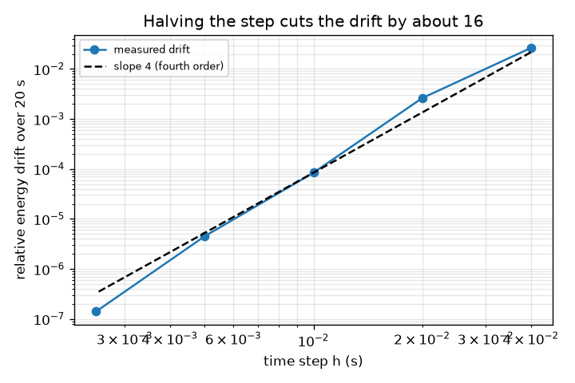
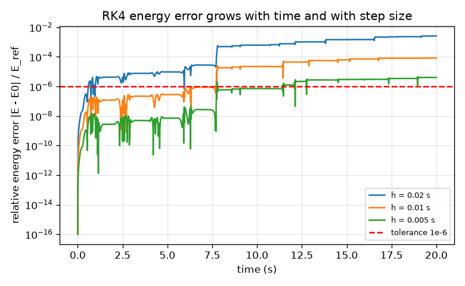
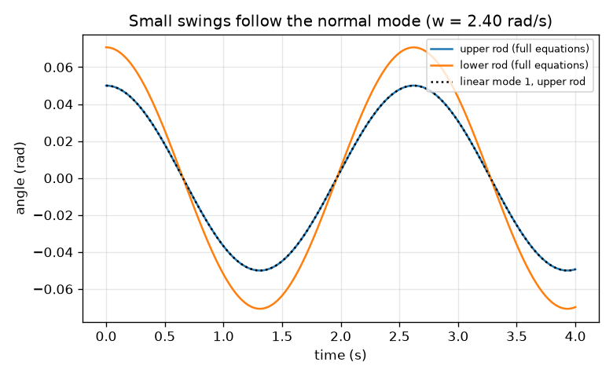

# Session 2: Equations, energy and a trustworthy simulation

*Level 2 (mathematical engineering model) · about 75 minutes · openchaos*

> This is a simplified educational model. It is not a validated design tool and must not be used for real structures, electrical installations, vehicles, industrial processes or medical decisions.

**Prerequisites**

- Session 1: the single and the double pendulum.
- Derivatives as rates of change (angular speed and angular acceleration); matrices are explained in Section B.

**Learning objectives.** After this session you can:

- Write the two angular accelerations of a double pendulum for general masses and lengths.
- Compute the kinetic, potential and total energy and use energy drift to test a simulation.
- Compute the two normal-mode frequencies of the linearised system and compare them with the simulation.
- Choose a time step so that the energy drift stays below a tolerance.

## A. Real-world problem
Before anyone believes your simulation you must be able to check it. For a double pendulum there is no formula for the motion, but two things are certain: with no friction the total energy (movement plus height) must stay constant, and for tiny swings the motion must reduce to two simple patterns whose frequencies can be calculated by hand. A weather office or a robot-arm maker runs exactly such tests before trusting a model. Which time step is small enough, and how do we know?

## B. Concept and theory
Take two point masses m1 and m2 on rods of lengths l1 and l2, with angles theta1 and theta2 from straight down. The Lagrangian method (kinetic energy minus potential energy, with the angles as coordinates) gives two coupled equations for the angular accelerations; they are written out below and also in matrix form, M(theta) theta'' = force terms, which we use as an independent check. The total energy E = T + V is constant. For small angles sin x is about x and cos x about 1, so the equations become linear, M theta'' = -K theta, and the motion is a sum of two normal modes: patterns in which both rods swing at one common frequency w. The frequencies satisfy det(K - w^2 M) = 0. For equal masses and rods w^2 = (g / l)(2 -/+ sqrt 2), that is 2.397 rad/s (rods swing in the same direction, the lower one 1.414 times as far) and 5.787 rad/s (rods swing in opposite directions). To advance the motion in time we use RK4 with step h; its error per unit time is proportional to h^4, so halving h should cut an error by about 16.

| Symbol | Meaning | Unit |
|---|---|---|
| theta1, theta2 | angles of the upper and lower rod from straight down | rad |
| omega1, omega2 | angular speeds | rad/s |
| m1, m2 | masses of the two balls | kg |
| l1, l2 | lengths of the two rods | m |
| g | gravity (9.81) | m/s^2 |
| T, V, E | kinetic, potential and total energy (height measured from the pivot) | J |
| E_ref | energy scale (m1 + m2) g l1 + m2 g l2 | J |
| h | time step of the solver | s |
| w | normal-mode frequency of small swings | rad/s |

**Assumptions**

- Point masses on rigid, massless rods; no friction; motion in one vertical plane.
- Energy drift is measured as max |E(t) - E(0)| / E_ref over the run.
- The small-angle limit needs angles of a few thousandths of a radian: our test uses an amplitude of 0.001 rad.
- Time-step results are for a release at 120 degrees with equal masses and rods over 20 s; other starts give other numbers.

$$ \ddot\theta_1=\frac{-g(2m_1+m_2)\sin\theta_1-m_2g\sin(\theta_1-2\theta_2)-2\sin(\theta_1-\theta_2)\,m_2\left(\dot\theta_2^{2}l_2+\dot\theta_1^{2}l_1\cos(\theta_1-\theta_2)\right)}{l_1\left(2m_1+m_2-m_2\cos(2\theta_1-2\theta_2)\right)} $$

$$ \ddot\theta_2=\frac{2\sin(\theta_1-\theta_2)\left(\dot\theta_1^{2}l_1(m_1+m_2)+g(m_1+m_2)\cos\theta_1+\dot\theta_2^{2}l_2m_2\cos(\theta_1-\theta_2)\right)}{l_2\left(2m_1+m_2-m_2\cos(2\theta_1-2\theta_2)\right)} $$

$$ T=\tfrac12(m_1+m_2)l_1^2\dot\theta_1^2+\tfrac12m_2l_2^2\dot\theta_2^2+m_2l_1l_2\dot\theta_1\dot\theta_2\cos(\theta_1-\theta_2),\qquad V=-(m_1+m_2)gl_1\cos\theta_1-m_2gl_2\cos\theta_2 $$

$$ \det(K-\omega^{2}M)=0,\quad M=\begin{pmatrix}(m_1+m_2)l_1^2 & m_2l_1l_2\\ m_2l_1l_2 & m_2l_2^2\end{pmatrix},\ K=\begin{pmatrix}(m_1+m_2)gl_1 & 0\\ 0 & m_2gl_2\end{pmatrix} $$

$$ \omega^{2}=\frac{g}{l}\left(2\mp\sqrt{2}\right)\quad\text{(equal masses and rods)} $$

## C. Visual explanation
Figure 1 plots the relative energy error against time for steps of 0.02, 0.01 and 0.005 s: all three grow with time, and the smaller step is much better. Figure 2 plots the drift over 20 s against h on log axes: 2.6e-3 for h = 0.02 s, 8.4e-5 for 0.01 s, 4.5e-6 for 0.005 s and 1.4e-7 for 0.0025 s, close to the dashed slope-4 line (the drop per halving is between 19 and 32 here, not exactly 16, because the energy error of a chaotic run is not smooth). Figure 3 shows a swing of amplitude 0.05 rad in the slow mode: the full equations and the dotted linear mode (2.397 rad/s) lie on top of each other.

*Energy drift over 20 s against step size: close to the slope-4 line of a fourth-order method.*

*Relative energy error against time for three time steps; red line: tolerance 1e-6.*

*A small swing in the slow normal mode: the full equations follow the linear mode (dotted).*

## D. Interactive simulation
Run the lesson (`python start.py 2`), then open the live app: [Session 2: energy error and normal modes](https://krunalpanchal1995.github.io/openchaos/session-02/) (or `app.html` in this folder). Move the step slider and read the worst energy error; switch to the drift graph to see where the blue curve crosses the red tolerance line, then to the modes graph and change the mass ratio.

**Challenge.** Release from at least 100 degrees with a mass ratio of at most 1.5 and keep the energy error below 1e-5 over 20 s.

## E. Worked example and experiment
**Problem.** For equal masses (1 kg) and equal rods (1 m), find the two small-swing frequencies and periods, and check them against a simulation of amplitude 0.001 rad.

1. For equal masses and rods w^2 = (g / l)(2 -/+ sqrt 2) with g / l = 9.81 s^-2 and sqrt 2 = 1.4142.
2. Slow mode: w^2 = 9.81 x 0.5858 = 5.747 s^-2, so w = 2.397 rad/s and the period is 2 pi / 2.397 = 2.621 s.
3. Fast mode: w^2 = 9.81 x 3.4142 = 33.49 s^-2, so w = 5.787 rad/s and the period is 2 pi / 5.787 = 1.086 s.
4. Mode shapes: theta2 / theta1 = +1.414 for the slow mode and -1.414 for the fast mode.
5. Start the simulation at rest with theta1 = 0.001 rad and theta2 = 0.001414 rad (slow mode): over 3 s the largest difference from 0.001 cos(2.397 t) is 8.9e-10 rad; for the fast mode it is 4.5e-8 rad. The nonlinear model agrees with the hand result to far better than 1e-6 rad.

**Answer.** Frequencies 2.397 and 5.787 rad/s (periods 2.621 s and 1.086 s); the simulation matches to better than 1e-7 rad.

**Experiment.** Hang two equal washers on two 20 cm rods (a stiff wire or a ruler with a hinge) and set the lower rod swinging with a small push in the same direction as the upper rod: count swings in 10 s. With l = 0.2 m the slow-mode frequency is 2.397 x sqrt(1 / 0.2) = 5.36 rad/s, about 8.5 swings per 10 s. Expect a lower number in practice: hinge friction, rod mass and the washers not being point masses all shift the frequencies, and the energy slowly drains away. The model is an idealisation, the checks prove the code solves the model, not that the model is the real pendulum.

## F. Assessment and design challenge
**Question type A: Conceptual.** If a simulation keeps the total energy constant to 1e-9, does that prove it is correct? What else would you test?

Hint

Think of a simulation that moves the pendulum on the right energy shell but at the wrong speed.

Step-by-step solution

No. Energy conservation is necessary, not sufficient: a solver could keep E constant and still get the timing (phase) of the swing wrong, or solve slightly different equations that also conserve a similar energy. We also compare with cases that have a known answer: the small-angle normal modes, hanging at rest, and an independent form of the equations (mass-matrix form), and we check that the error shrinks as the step shrinks.

**Question type B: Numerical.** Find the total energy of a double pendulum with m1 = m2 = 1 kg, l1 = l2 = 1 m, released from rest with both rods at 60 degrees. Then repeat for 90 degrees. Give units and say whether the signs make sense.

Hint

At rest T = 0 and V = -(m1 + m2) g l1 cos(theta1) - m2 g l2 cos(theta2) with equal angles.

Step-by-step solution

V = -3 g cos(theta) with g = 9.81. At 60 degrees cos = 0.5 so E = -14.715 J; at 90 degrees cos = 0 so E = 0 J. Height is measured from the pivot, so hanging below the pivot is negative energy; at 90 degrees the balls are level with the pivot, zero height. Hanging at rest is the lowest energy, -3 g = -29.43 J.

**Question type C: Graph and simulation interpretation.** On the drift-versus-step graph, which of the tested steps keeps the energy error below 1e-5 over 20 s, and by about what factor does the error fall when you halve h from 0.01 s to 0.005 s?

Hint

Read the points at 0.01 s and 0.005 s, then divide.

Step-by-step solution

The error is 8.4e-5 at 0.01 s (too large) and 4.5e-6 at 0.005 s (below 1e-5). Halving the step cuts it by 8.4e-5 / 4.5e-6 = 18.6, close to the 2^4 = 16 expected for a fourth-order method.

**Question type D: Design and optimisation challenge.** Design: choose a step for a 20 s run released at 120 degrees with energy error below 1e-6. Compare the cost with the step that gives 1e-5. State the trade-off.

Hint

Use largest_step(1e-6, ...) with the candidates 0.04, 0.02, 0.01, 0.005, 0.0025 s.

Step-by-step solution

0.0025 s gives 1.4e-7 (passes) and 0.005 s gives 4.5e-6 (fails 1e-6, passes 1e-5). So 0.0025 s for 1e-6 needs 8000 steps, against 4000 steps with 0.005 s for 1e-5: twice the work for 30 times less error. RK4 makes four rate evaluations per step, so 32000 against 16000. Trade-off: accuracy against run time; also, for a chaotic motion extra accuracy extends how long the run follows the true path only slowly (Session 3).

Score yourself with [RUBRIC.md](../../RUBRIC.md). Print the [activity sheet](activity_sheet.md) to work on paper.

## Common misconceptions
| Common misconception | What is actually true |
|---|---|
| Constant energy proves the simulation is right. | It is a necessary check only; also test known cases (small angles, equilibrium) and an independent form of the equations. |
| The smaller the step, the better, always. | Smaller steps cost more work and eventually round-off error limits the gain; choose the step from a tolerance. |
| Normal modes describe any motion of the double pendulum. | They are exact only in the small-angle limit; large swings mix the modes and are chaotic. |
| The double pendulum has one natural frequency like a single pendulum. | It has two (2.397 and 5.787 rad/s for equal masses and rods), and for large swings the idea of one frequency breaks down. |

## Glossary
- **Lagrangian**: kinetic energy minus potential energy; the equations of motion follow from it
- **energy drift**: slow change of the total energy in a simulation that should conserve it
- **normal mode**: a pattern in which all parts of a small-swing system move at one common frequency
- **linearise**: replace sin x by x and cos x by 1 for small angles so that the equations become linear
- **mass matrix**: the 2x2 table M that multiplies the accelerations in the equations of motion
- **tolerance**: the largest error we accept

## Finish
1. Do the three coding tasks in [exercises.md](exercises.md).
2. Run `python start.py 2` again after your changes. It ends with the checkpoint; when it prints `PASS`, you are done. (Checkpoint only: `python start.py check 2`.)

Next: [Session 3](../session-03/README.md)
