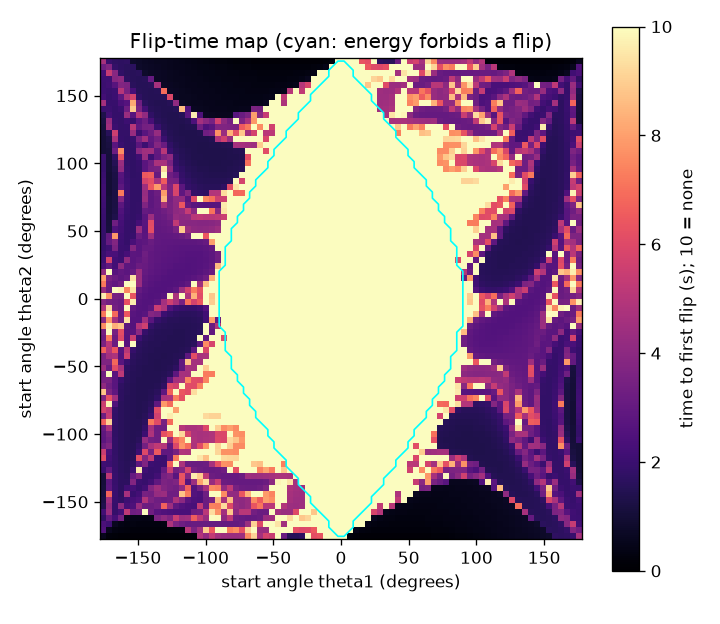
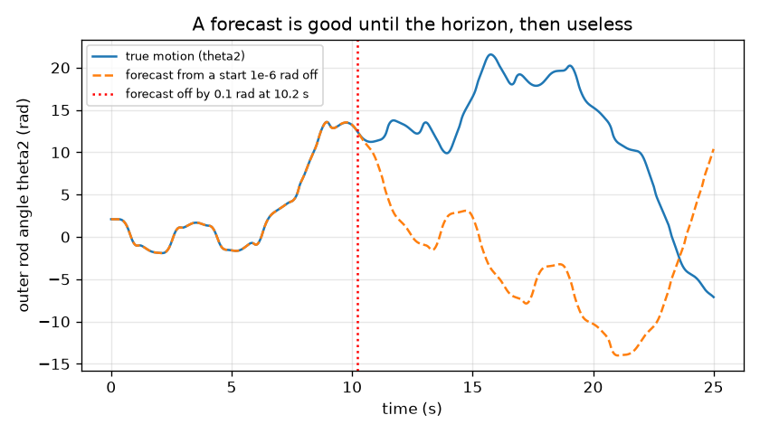
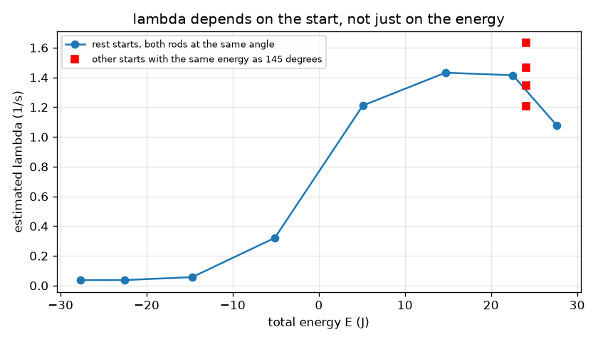
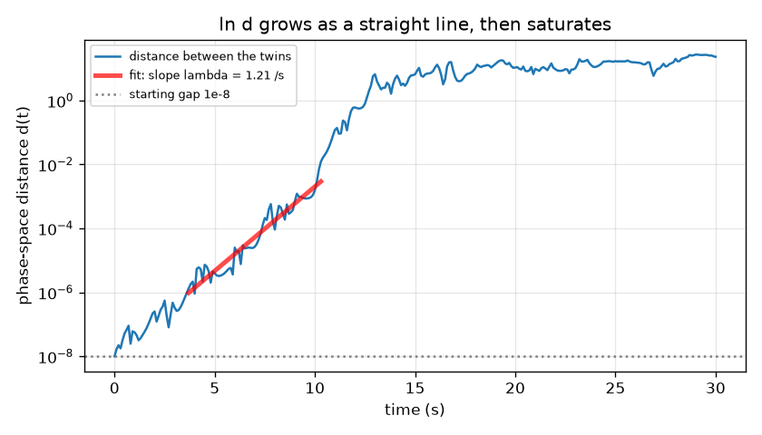
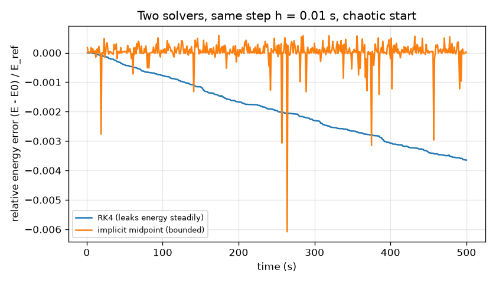

# Session 3: Measuring chaos and the limits of forecasting

*Level 3 (simulation and validation) · about 90 minutes · openchaos*

> This is a simplified educational model. It is not a validated design tool and must not be used for real structures, electrical installations, vehicles, industrial processes or medical decisions.

**Prerequisites**

- Session 1: sensitive dependence on the start.
- Session 2: the equations, energy and the RK4 solver.
- Logarithms: ln(a b) = ln a + ln b, and ln of an exponential is a straight line.

**Learning objectives.** After this session you can:

- Compare RK4 with a symplectic solver (implicit midpoint) by their energy drift over a long run.
- Estimate the largest Lyapunov exponent from the straight-line growth of the log of a separation, and by the Benettin method.
- Build a flip-time map of release angles and validate it against an energy argument.
- Compute a predictability horizon and say why it grows only logarithmically with the measurement precision.

## A. Real-world problem
Weather models, satellite orbits and robot arms all meet the same wall: a tiny error in the starting measurement grows until the forecast is useless. The double pendulum shows it on a table top. Today we ask the quantitative questions. How fast does a tiny error grow? For which starts is the motion regular and for which chaotic? And if a lab can measure the start to 1e-6 rad, for how many seconds can the forecast be trusted?

## B. Concept and theory
Two solvers are compared. RK4 is very accurate over a short time but leaks energy steadily. The implicit midpoint rule, applied to the Hamiltonian form with positions and momenta, is symplectic: its energy error does not grow however long we run, though it is larger at first (it is only second order). For sensitivity, start two copies delta0 apart and track the distance d(t) between them in the four-dimensional space of angles and angular speeds. While d is small, d(t) is about delta0 exp(lambda t), so ln d is a straight line against t whose slope is the largest Lyapunov exponent lambda (units 1/s). A positive lambda means chaos. The line stops when d is as large as the motion itself (saturation), so we fit only between d = 1e-6 and 1e-2. The Benettin method pulls the twin back to distance delta0 every 0.1 s and averages the logarithm of the growth. Both estimates belong to one start only: lambda depends on the initial condition, and near zero it cannot be told from zero in a finite run. The flip-time map releases the pendulum from rest on a grid of (theta1, theta2) and records when the outer rod first goes over the top; stripes and speckles mark chaos. Validation by energy: kinetic energy is never negative, so the outer rod can reach the top only if the energy E = -2 g cos(theta1) - g cos(theta2) is at least -g, so any start with 2 cos(theta1) + cos(theta2) > 1 can never flip. Finally, if the start error is delta0 and we accept an error Delta, the forecast fails at t = ln(Delta / delta0) / lambda.

| Symbol | Meaning | Unit |
|---|---|---|
| delta0 | size of the start error | rad (or mixed rad and rad/s) |
| d(t) | distance between the two runs in angle and angular-speed space | mixed rad and rad/s |
| lambda | largest Lyapunov exponent | 1/s |
| Delta | largest forecast error we accept (0.1) | rad |
| t_h | predictability horizon | s |
| h | time step | s |
| E | total energy, equal to -2 g cos(theta1) - g cos(theta2) for a rest start | J |
| q, p | positions (angles) and momenta of the Hamiltonian form | rad, kg m^2/s |

**Assumptions**

- Equal masses (1 kg) and rods (1 m), no friction; all starts are at rest except in the error experiments.
- The Lyapunov exponent is estimated over finite times (30 to 60 s), so values near zero mean 'regular within the accuracy of this method'.
- The flip-time map uses RK4 with h = 0.02 s, 80 x 80 starts and gives up after 10 s; the pattern of stripes depends on that resolution.
- The horizon formula uses a single exponential growth rate; real growth wanders around it, so it is accurate to about 25 percent.

$$ d(t)\approx\delta_0\,e^{\lambda t}\ \Longleftrightarrow\ \ln d(t)=\ln\delta_0+\lambda t $$

$$ \lambda\approx\frac1T\sum_{k}\ln\frac{d_k}{\delta_0}\quad\text{(Benettin: the gap is reset to }\delta_0\text{ after each interval)} $$

$$ z_{n+1}=z_n+h\,F\!\left(\tfrac12(z_n+z_{n+1})\right),\qquad \dot q=M^{-1}p,\ \ \dot p=-\partial_qH $$

$$ 2\cos\theta_1+\cos\theta_2>1\ \Longrightarrow\ E<-g\ \Longrightarrow\ \text{the outer rod cannot flip} $$

$$ t_h=\frac{1}{\lambda}\ln\frac{\Delta}{\delta_0} $$

## C. Visual explanation
Figure 1 shows the energy error of the two solvers for a 500 s chaotic run with h = 0.01 s: the RK4 error is smaller at first (4.0e-4 after 50 s against 2.8e-3 for the midpoint rule) but keeps growing, whereas the midpoint error stays bounded (worst values 3.6e-3 for RK4 and 6.1e-3 for the midpoint rule). Figure 2 shows ln d(t) for a 120 degree release: a straight rising segment from d = 1e-6 at 3.7 s to d = 1e-2 at 10.3 s, then saturation. Figure 3 plots lambda against the energy of the rest starts (both rods at the same angle): about 0.04 to 0.06 per second up to 60 degrees (regular), 0.32 at 80, 1.2 at 100 and about 1.4 at 120 and 140 degrees, with a spread of 1.2 to 1.6 for different starts at the same energy. Figure 4 is the flip-time map: 43 percent of the starts never flip within 10 s, and the outline of the energy-forbidden region (2 cos(theta1) + cos(theta2) > 1) encloses a dark region with no flip at all. Figure 5 shows a forecast started 1e-6 rad off: it follows the true motion until about 10 s and then departs.

*Flip-time map of 80 x 80 rest starts; the cyan outline marks where energy forbids a flip.*

*A forecast started 1e-6 rad off follows the true motion, then departs at about 10 s.*

*Estimated Lyapunov exponent against energy; red squares: other starts with the same energy as the 145 degree release.*

*Distance between two runs: a straight line on the log axis (slope lambda), then saturation.*

*Energy error of RK4 and the implicit midpoint rule over 500 s: RK4 leaks steadily, the symplectic rule stays bounded.*

## D. Interactive simulation
Run the lesson (`python start.py 3`), then open the live app: [Session 3: flip-time map and forecast horizon](https://krunalpanchal1995.github.io/openchaos/session-03/) (or `app.html` in this folder). Pick a start on the flip-time map (the outline shows where energy forbids a flip), set the measurement error exponent, and read the forecast horizon on the divergence graph.

**Challenge.** Find a start from which energy alone forbids the outer rod from flipping.

## E. Worked example and experiment
**Problem.** A lab measures the starting angles of a double pendulum to 1e-6 rad. If lambda = 1.4 per second and we accept an error of 0.1 rad, how long is the forecast good? How much longer if the measurement is a thousand times better?

1. t_h = ln(Delta / delta0) / lambda = ln(0.1 / 1e-6) / 1.4 = ln(100000) / 1.4.
2. ln(100000) = 11.513, so t_h = 11.513 / 1.4 = 8.22 s.
3. With delta0 = 1e-9: ln(1e8) = 18.421, so t_h = 18.421 / 1.4 = 13.16 s.
4. The gain is ln(1000) / 1.4 = 6.908 / 1.4 = 4.93 s: a thousand times better instruments buy about five seconds.
5. Check with the simulation for the 120 degree release: the Benettin lambda is 1.43 per second, so the formula gives 8.05 s, and a forecast started 1e-6 rad off in theta1 fails (0.1 rad) at 10.2 s. The median over random error directions is 10.3 s, a factor 1.3 longer than the formula; with 1e-9 the median is 16.8 s (gain 6.5 s).

**Answer.** About 8.2 s with 1e-6 rad (formula; 10 s measured for this start) and only about 5 to 7 s more with a thousand times better measurement.

**Experiment.** Run the lesson with two different time steps for the same start (0.01 s and 0.005 s) and compare them with a very fine reference of 0.001 s: the coarse run leaves the reference by 0.1 rad after 10.2 s, the finer after 10.9 s, a large step (0.1 s) after only 3.5 s. A real pendulum behaves the same way, plus friction: the pivot, air drag and the measurement of the start each add errors much larger than 1e-6 rad, so real forecasts of a double pendulum fail after a few seconds. The model has no friction, which keeps its chaos alive for ever; a real one slowly loses energy and calms down.

## Real-world application and mini-project: How long can you forecast a double pendulum?
A lab can measure the two starting angles of a double pendulum to within 1e-6 rad. Released from rest with both rods at 100, 120 or 140 degrees, for how long does a forecast stay within 0.1 rad of the true motion? Use `benettin`, `predicted_horizon` and `median_horizon` from Session 3 (20 random error directions, seed 7).

**Deliverable:** A script that prints, for each of the three releases, the Lyapunov exponent, the horizon predicted by ln(0.1 / 1e-6) / lambda and the median horizon measured by simulation; names the release with the longest horizon; and finally prints how much the horizon grows for a measurement a thousand times better (1e-9 rad) at the 120 degree release.

**Success looks like:** The longest median horizon is for the 120 degree release, about 10.3 s (the 100 and 140 degree releases give about 8.7 s and 8.3 s); the formula is within 30 percent of each measured value; and the 1e-9 rad measurement lengthens the 120 degree horizon by only about 6.5 s (to about 16.8 s), not by a factor of a thousand.

## F. Assessment and design challenge
**Question type A: Conceptual.** A colleague proposes to forecast a chaotic system for twice as long by buying a measuring device twice as precise. Explain why this does not work and what would be needed instead.

Hint

Use t_h = ln(Delta / delta0) / lambda.

Step-by-step solution

The horizon depends on the logarithm of the precision: halving delta0 adds only ln 2 / lambda, about 0.5 s for lambda = 1.4 per second. To double a 10 s horizon you would need delta0 about e^14 = a million times smaller. Better options are to accept a larger error Delta (which also helps only logarithmically), to forecast statistics (averages and probabilities) instead of the exact path, or to correct the forecast with new measurements as time goes on.

**Question type B: Numerical.** For lambda = 1.2 per second, a start error of 1e-8 rad and an accepted error of 0.5 rad, find the predictability horizon. Give the units and a sanity check.

Hint

t_h = ln(Delta / delta0) / lambda.

Step-by-step solution

Delta / delta0 = 0.5 / 1e-8 = 5e7, ln(5e7) = 17.73, so t_h = 17.73 / 1.2 = 14.8 s. Sanity check: with delta0 = 1e-8 and Delta = 0.1 the earlier simulation passed 0.1 rad at about 13 s; a larger tolerance and slightly smaller lambda give a bit more, so 15 s is plausible.

**Question type C: Graph and simulation interpretation.** In Figure 2 the straight segment rises from d = 1e-6 at 3.7 s to d = 1e-2 at 10.3 s, while the least-squares fit over that window gives lambda = 1.21 per second and the Benettin method 1.43 per second. Estimate lambda from the two end points, and explain why the three numbers differ.

Hint

Slope of ln d: ln(1e-2 / 1e-6) divided by the time between the two points.

Step-by-step solution

ln(1e4) = 9.21 over 6.6 s gives 1.40 per second. The fit (1.21) and Benettin (1.43) differ because the growth rate is not constant along the orbit: the pendulum alternates between phases of fast and slow stretching, so a finite-time estimate depends on the window and the length of the run. Quote lambda with this uncertainty (here about 1.2 to 1.5 per second) and say for which start it was measured.

**Question type D: Design and optimisation challenge.** Design: you want a 15 s forecast within 0.1 rad for the 120 degree release (lambda about 1.43 per second). What start precision does the formula demand? Is it realistic for a rotary encoder of 1e-5 rad resolution? What would you do instead?

Hint

Solve t_h = 15 s for delta0: delta0 = Delta exp(-lambda t_h).

Step-by-step solution

delta0 = 0.1 exp(-1.43 x 15) = 0.1 exp(-21.45) = 4.8e-11 rad, a million times finer than a 1e-5 rad encoder, which would give only about 5 s by the formula. It is not realistic. Alternatives: shorten the horizon you promise, accept 1 rad error (gain ln(10) / 1.43 = 1.6 s only), use repeated measurements to correct the forecast, or forecast the probability of a flip rather than the path. Assumption: friction and the model error are neglected, which would make things worse in reality.

Score yourself with [RUBRIC.md](../../RUBRIC.md). Print the [activity sheet](activity_sheet.md) to work on paper.

## Common misconceptions
| Common misconception | What is actually true |
|---|---|
| Chaos is random noise in the equations. | The equations are exact; the flip-time map's speckle is fine structure caused by sensitivity, and it keeps refining when the grid is refined. |
| The system has one Lyapunov exponent. | Lambda is a property of the motion: it depends on the start (0.04 per second at 20 degrees, 1.4 per second at 120 degrees, and a spread at one energy). |
| A symplectic solver is always more accurate than RK4. | It keeps the energy error bounded for very long runs, but over short runs RK4 with the same step has a smaller error (4.0e-4 against 2.8e-3 after 50 s). |
| A smaller step lets you predict chaos for ever. | Numerical error acts like a measurement error: each step adds a little, so the horizon grows only logarithmically as h shrinks (10.2 s for 0.01 s, 10.9 s for 0.005 s). |

## Glossary
- **Lyapunov exponent**: the average exponential growth rate of a tiny separation between two runs (1/s); positive means chaos
- **symplectic**: a solver that preserves the geometric structure of mechanics, so energy errors stay bounded
- **implicit midpoint rule**: a second-order symplectic step that evaluates the rate at the middle of the step
- **saturation**: the stage where the separation is as big as the motion itself and stops growing exponentially
- **flip time**: the first time the outer rod swings over the top
- **predictability horizon**: the time after which a forecast with a given start error exceeds the accepted error
- **Benettin method**: estimating lambda by repeatedly resetting the gap between two runs to a small value

## Finish
1. Do the three coding tasks in [exercises.md](exercises.md).
2. Run `python start.py 3` again after your changes. It ends with the checkpoint; when it prints `PASS`, you are done. (Checkpoint only: `python start.py check 3`.)

Next: the [roadmap](../../promo/roadmap.md). Session 4 is yours to build.
